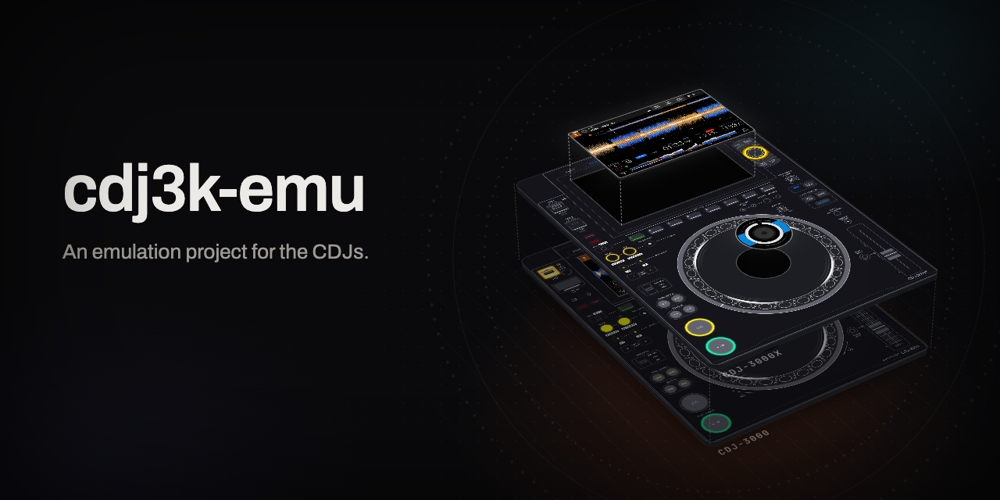
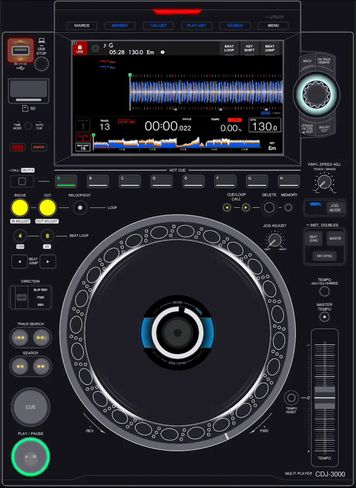

A desktop app for macOS, Linux and Windows that boots a CDJ's firmware inside QEMU and
shows the device's main LCD, jog LCD, jog wheel, faders, buttons, USB, PC-Link, and Pro DJ Link network in a native window.

<table>
<tr>
<td valign="top" width="50%">

<sub><em>The emulated players' slates · <a href="docs/preview.png">full preview</a></em></sub>
</td>
<td valign="middle" align="center" width="50%">
  
  <sub><em>Interacting with the firmware and controls</em></sub>
</td>
</tr>
</table>

## Why this exists

The project exists mainly for the technical challenge of putting a piece of
proprietary, tightly coupled DJ hardware on a host hypervisor while its real
firmware keeps working. The interesting parts are the small surfaces between a
stock Linux kernel and the Pioneer userspace: DRM/KMS for the jog LCD, the SPI
sub-CPU protocol for the controls, and the virtio-snd cadence that EP122's
audio callback expects.

A secondary goal is a reproducible bench for studying the **Pro DJ Link
(DJPL)** network protocol: beat broadcasts, the master/slave hand-off, abs-pos
sync, and the relationship between audible playback and what other players see
on the wire. Several emulator slots on the same host let you observe both ends
of a sync transaction with a packet capture between them, which is harder to do
with real CDJs on a physical LAN.

> [!TIP]
>
> ## What it is
>
> - A user-space wrapper around QEMU `aarch64-virt` running a vanilla Linux 6.6
>   kernel, with a small set of out-of-tree modules and an LD_PRELOAD shim that emulate
>   the Pioneer-specific hardware:
> - **virtio_snd** for audio (custom kernel module sized for the EP122 audio
>   callback cadence).
> - **subucom_virt** for the SPI sub-CPU protocol (buttons, jog encoder,
>   rotary, slider, capacitive sensors).
> - **deck_shim** (LD_PRELOAD), which emulates the Rockchip-specific DRM/KMS
>   ABI that EP122 expects (the jog LCD as DSI-2, vsync_time, and so on) and
>   routes the jog LCD pixels through ivshmem so the host renders them as an
>   egui texture.

> [!CAUTION]
>
> ## What it is **not**
>
> - **It does not ship Pioneer firmware.** You need to supply your own copy
>   of the deck's firmware update file (`.UPD`) and decryption key at first launch.
>   The in-app **Install Firmware** wizard decrypts it locally and provisions
>   a per-instance eMMC qcow2 disk image under `~/Library/Application Support/com.cdj3k.emu/`
>   (`~/.local/share/com.cdj3k.emu/` on Linux, `%LOCALAPPDATA%\com.cdj3k.emu\` on Windows).
>   Nothing Pioneer-owned is in this repository or the distributed bundle.
> - Not endorsed by, affiliated with, or sponsored by AlphaTheta Corporation /
>   Pioneer DJ. CDJ, rekordbox, and Pro DJ Link are trademarks of their
>   respective owners.
> - Not a frame-accurate hardware simulator. Pixel output and SPI timings are
>   close enough to run EP122 and EP145 (the stock firmware) for everyday use.
> - Not a turntable replacement. The jog wheel and rotaries are driven with
>   pointer drags and the scroll wheel; an external MIDI controller cannot
>   drive the emulated SPI bus.
> - macOS (Apple silicon, Intel), Linux (aarch64, x86_64) and Windows (arm64, x64) only;
>   see [Platform support](docs/platform-support.md) for what differs.
> - **Not compatible with pre-3.00 firmware.** See _Firmware compatibility_
>   below — on the CDJ-3000, only firmware 3.00 and newer is accepted.

## Firmware compatibility

> [!IMPORTANT]  
> On the CDJ-3000, cdj3k-emu accepts **firmware version 3.00 or newer** only.
>
> All CDJ-3000X/CDJ-1500X firmwares are supported.

Pioneer shipped two different system-on-chip families across the CDJ-3000's
lifetime:

- **Renesas G2M**, used in firmware **1.x and 2.x**. It has a different
  kernel, a very different driver stack and a different DRM/KMS path for the
  jog LCD. cdj3k-emu does **not** support this hardware target.
- **Rockchip RK3399**, used in firmware **3.00 and newer**. This is the target
  cdj3k-emu emulates: the vanilla Linux 6.6 aarch64 kernel, the `deck_shim`
  LD_PRELOAD, the `subucom_virt` SPI emulation and the `virtio_snd` audio
  pipeline are all written against the RK3399 userspace that the 3.00+
  firmware ships.

If your `.UPD` decrypts to a Renesas G2M kernel and rootfs, the firmware
wizard rejects it before provisioning the eMMC image. Use a 3.00+ update file.

## Emulated models

`--model <slug>` (or `CDJ3K_MODEL`) skips the picker; slugs are `cdj3k`,
`cdj3kx`, `cdj1500x`. A slot holds one installation, and its model is
persisted in the slot's settings (see [Storage](docs/storage.md)).

| Model         | Board / kernel             | Panel             | Status                    |
| ------------- | -------------------------- | ----------------- | ------------------------- |
| **CDJ-3000**  | RK3399, vanilla 6.6 kernel | 9-inch display    | Boots, Plays, Pro DJ Link |
| **CDJ-3000X** | RK3399, vanilla 6.6 kernel | 10.1-inch display | Boots, Plays, Pro DJ Link |
| **CDJ-1500X** | RK3566, vanilla 6.6 kernel | 10.1-inch display | Boots, Plays, Pro DJ Link |

See [Models and slates](docs/models.md).

## About the decryption key

Pioneer ships firmware updates as `.UPD` files whose payload is LUKS-encrypted.
The "decryption key" the firmware wizard asks for is the LUKS keyfile that
unlocks that payload, so the wizard can mount it and extract the kernel and
rootfs.

This repository does **not** ship that key, for the same reason it does not
ship the `.UPD` itself: it is Pioneer-controlled material that this project
has no right to redistribute. Nothing Pioneer-owned is in the repository or in
the bundle. Getting the keyfile is the user's responsibility, by whatever means
they are entitled to.

## System requirements

### macOS

- **macOS 15 (Sequoia) or newer**, one universal app.
- **Apple silicon runs under HVF** with Apple's **in-kernel ARM vGIC**
  (`hv_gic_create`), which removes the vCPU exit on each interrupt; those
  exits dominate the cost of EP122's interrupt load. If the vGIC is refused,
  QEMU falls back to userspace GIC emulation (`kernel-irqchip=off`).
- **Intel runs under software emulation (TCG)**: HVF virtualizes only x86
  guests there.

### Linux

- A Wayland or X11 desktop with GL 3.3, PipeWire, and udisks2.
- **aarch64 with KVM** (`/dev/kvm`, user in the `kvm` group) runs at full
  speed. **x86_64 runs under software emulation (TCG).**
- `/dev/shm` with 3 GiB free, and 29.1 GB free for each slot's eMMC image.

### Windows

- **Windows 10 2004 (build 19041) or newer**, x64 or arm64; one installer per
  architecture.
- **arm64 runs under WHPX** on Windows 11 24H2 build 26100.3915 or later with
  the Windows Hypervisor Platform feature on (the installer enables it and asks
  for a restart). **x64, and arm64 without that build or that feature, run
  under software emulation (TCG).**
- Bridged Pro DJ Link through `netsh bridge` needs Windows 11 22H2 with
  KB5030310; on older builds the Network Bridge is made by hand in Network
  Connections.
- 29.1 GB free for each slot's eMMC image.

### Every host

- Roughly 8 GB of free RAM to run two instances at once (3 GiB for each
  guest, plus the host's overhead).
- A firmware update file for a supported model, and its decryption key if it needs one.

## Known limitations

- Audio is not a bit-perfect reproduction of the real hardware. The CDJ-3000
  has dedicated audio silicon with its own clock domain and DSP path. The
  emulator routes the firmware's PCM through `virtio_snd`, then a QEMU bypass
  ring, then CoreAudio, PipeWire or WASAPI, which is a different pipeline.
  Occasional pops and transient artifacts can occur, especially under host CPU
  pressure or when the host device clock drifts against the guest. The
  pipeline mitigates this with a lock-free SPSC ring, a dedicated RT writer
  thread, soft-PLL clock-skew correction, a pipeline-depth watchdog and a
  RELEASE flush on recovery; see `docs/audio-stack.md`. Steady-state output on
  a device at the guest's rate is clean, but it is not identical to a physical
  CDJ-3000.
- Audio latency depends on the host audio queue depth; it is typically
  30-80 ms end to end with the bundled bypass-ring patches. ALC
  (**Audio › Enable ALC (Experimental)**) shifts the alignment between the
  audible output and the Pro DJ Link broadcasts to compensate, but adds a
  little jitter. It is on by default.
- The jog wheel is good enough for cueing but has no torque feedback. The
  brake stop time follows the `jog_adjust` rotary as on the deck, so stops
  take the same time even though the touch differs.
- Service Mode (**Emulation › Service Mode**, or `--service-mode`) boots the
  sub-CPU test mode through an injected button sequence. It is unreliable when
  the emulation runs too slowly. Some test routines that read hardware-only
  registers, such as the fan RPM, return fixed values.
- LINK MODE, where rekordbox reaches the emulated deck over the network, does
  not work.
- Over PC Link (USB-B), rekordbox is **blocked by its own HID probing** and
  does not connect. USB audio (UAC2) is **not supported**.

## Controls

### Jog wheel

You can control the jog wheel a few different ways:

- **Click and drag the center** to scratch.
- **Click and drag the outside ring** for a subtle pitch bend.
- **Scroll the mouse wheel** anywhere on the jog to bend the pitch.
- **Hold Ctrl, click and drag, then release ("slingshot")** to flick the wheel. A line shows the pull; the faster you pull, the more the wheel spins.

### Using multiple controls at once

On a real CDJ, you can hold a button or touch the screen while doing something else, like turning the jog wheel. With a mouse, there's only one pointer, so you can hold **Ctrl** to "latch" a button or touchscreen press:

- **Ctrl-click a button**: the button stays pressed until you release Ctrl.
- **Ctrl-click the LCD touchscreen**: the touch stays down until you release Ctrl.

This lets you, for example, keep `Search Forward` held down while moving the jog wheel to search faster, just like on real hardware.

## Mods

Mods change what runs on the emulated deck. Each slot has its own, installed from a file or a local folder under **Emulation › Manage Emulation › Manage mods**. See [Mods](docs/mods.md).

### Supported mods

[cdj3k-mods](https://github.com/nsaintot/cdj3k-mods) (Smart/Gate/Preview cues, MOD SETTINGS, Themes, STEMS, X-PAD).

## Developer Mode

**Emulation › Developer Mode** (or `--dev`) opens the slot's control API on TCP
port 4400 + slot and QEMU's gdb stub on port 1235 + slot. Scripts and
`cdj3k-emu ctl` then press buttons, touch the screen, read the lamps, compare
LCD captures with reference images, run shell commands in the guest and follow
its journal. `--headless` runs a slot without a window. See
[Control API](docs/control-api.md). `cdj3k-emu ctl e2e` runs the scenarios in
`tests/e2e/` against ephemeral slots; see [E2E scenarios](docs/e2e.md).

## Building

See [Building](docs/building.md) for building from source on each host, and
[Releases and updates](docs/releases.md) for CI, the release flow, its
secrets and the update feeds.

## First-run privilege prompts

cdj3k-emu asks for elevation only when you ask it to do one of these.

### macOS

macOS asks for the admin password in three situations:

| Action                                                   | Why it elevates                                                                                                                                                                                                               |
| -------------------------------------------------------- | ----------------------------------------------------------------------------------------------------------------------------------------------------------------------------------------------------------------------------- |
| Selecting a TAP interface (OpenVPN-style) for Pro DJ Link | The app creates a macOS `bridge` and a `tap` for QEMU with `ifconfig`, which is root-only. Both are removed when the slot stops using them or the app exits. |
| Selecting a network interface or Host-only (link-local) on macOS 15 | On macOS 15 the `com.apple.developer.networking.vmnet` entitlement does not cover bridged mode and keeps host-only instances apart, so the app starts the bundled `socket_vmnet` as root. Slots on the same interface, or on Host-only, share one daemon, which stops when the last of them stops. On macOS 27 QEMU opens vmnet itself and no prompt appears. |
| Attaching a physical USB drive in pass-through mode      | `chmod 660` on `/dev/diskN` so QEMU can open it `O_RDWR`. The app checks the device path against `/dev/disk[0-9]+(s[0-9]+)?` before elevation (see `crates/cdj3k-emu-runtime/src/disk/macos.rs::is_valid_bsd_disk_path`). |

The TAP bridge and socket_vmnet ask through Authorization Services, and the
USB pass-through through an `osascript` admin prompt. All three use the native
macOS password dialog. No elevation gives the app lasting privileges. The root
processes it starts (the TAP bridge watcher, and socket_vmnet with its
watchdog) exit when the last slot using them stops.

### Linux

The desktop's polkit agent asks, in two situations:

| Action                                              | Why it elevates                                                                                                                                                                    |
| --------------------------------------------------- | ---------------------------------------------------------------------------------------------------------------------------------------------------------------------------------- |
| Bridging onto a NIC or a bridge for Pro DJ Link     | Creates a macvtap, or a tap on the bridge, through `pkexec`. The link lasts while the slot uses it, so each bridged start asks once. Picking an existing tap you own asks nothing. |
| Attaching a physical USB drive in pass-through mode | udisks opens the disk exclusively for the app (`org.freedesktop.udisks2.open-device`) when your user cannot. The host cannot mount it while the deck holds it.                     |

### Windows

UAC asks, in three situations:

| Action                                              | Why it elevates                                                                                                                                                                                                                                                        |
| --------------------------------------------------- | ---------------------------------------------------------------------------------------------------------------------------------------------------------------------------------------------------------------------------------------------------------------------- |
| Bridging onto a NIC for Pro DJ Link                 | The app re-runs itself elevated (`--windows-net-helper`) to create the slot's TAP-Windows6 adapter and join it and the NIC to the Network Bridge. A watcher it leaves running takes both down when the slot quits or changes network, so each bridged start asks once. |
| Attaching a physical USB drive in pass-through mode | When your user cannot open the disk, a PowerShell script grants it read and write on `\\.\PhysicalDriveN` and its volumes. The grant lasts until the disk is unplugged.                                                                                                |
| Creating a blank virtual USB image                  | Attaching the new VHDX to partition and format it (`Mount-DiskImage`, `Format-Volume`) is admin-only.                                                                                                                                                                  |

## Documentation and reference

- [Platform support](docs/platform-support.md)
- [Building](docs/building.md)
- [Releases and updates](docs/releases.md)
- [Audio stack](docs/audio-stack.md)
- [ALC](docs/alc.md)
- [Network stack](docs/network.md)
- [Storage](docs/storage.md)
- [PC-Link](docs/pc-link.md)
- [Mods](docs/mods.md)
- [Control API](docs/control-api.md)
- [E2E scenarios](docs/e2e.md)
- [Models and slates](docs/models.md)
- [Host/guest stream transports](docs/stream-transports.md)
- [subucom SPI protocol](docs/subucom.md)
- [G2M (Renesas) — unsupported target](docs/g2m-renesas.md)

## Repository layout

```
app/cdj3k-emu/       binary (eframe egui app and runtime worker)
crates/cdj3k-emu-*   Rust workspace: panel, streams, platform, control, ui,
                     runtime, storage, firmware
  ui/src/app/ui/       shared control toolkit and slate/<model>
guest/               C sources built for the guest:
  cfgd/                cdj3k-cfgd  - virtio-serial config daemon
  deck_shim/           deck_shim.so - LD_PRELOAD shim (core/ + per-model)
  subucom/             subucom_forwarder, subucom_live
  pc_link_bridge/      cdj3k-pc-link-bridge - bridge between the USB-B gadget and the host
  modules/             out-of-tree kernel modules (subucom_virt, virtio_snd, udev_usb1)
  kernel-patches/      vanilla 6.6 patches and the guest kernel .config
qemu/                upstream QEMU source and the overlay patches
winit/               winit fetched from crates.io and the overlay patch
dropbear/            static aarch64 dropbear for firmware without SSH
docker/              Alpine and Ubuntu build pipeline for guest artefacts, and
                     the Linux and Windows host-build images
packaging/macos/     staging (universal or one arch), signing, notarization, .dmg
packaging/linux/     staging, .deb/.rpm (nfpm) and AppImage
packaging/windows/   cross-build, staging and the Inno Setup installer
initramfs-patch/     numbered rootfs patch scripts (concatenated by the stagers)
scripts/             bundle-dylibs.sh (self-contained .app), bundle-sos.sh
                     (Linux $ORIGIN tree), bundle-dlls.sh (Windows DLLs)
```

## License

cdj3k-emu's original sources are dual-licensed at your option under either of:

- **Apache License, Version 2.0** ([LICENSE-APACHE](LICENSE-APACHE))
- **MIT License** ([LICENSE-MIT](LICENSE-MIT))

Linux kernel modules in `guest/modules/`, kernel patches in
`guest/kernel-patches/`, the QEMU embedding shim in `qemu/shim/`, and QEMU
patches in `qemu/patches/` are derivatives of GPL-2.0 upstreams and retain
**GPL-2.0-or-later**. See [NOTICE](NOTICE) for a full inventory of bundled
third-party components and the firmware-acquisition expectation.

## Contributing

Issues and pull requests are welcome. By submitting a contribution you agree it
is dual-licensed Apache-2.0 / MIT per [LICENSE-APACHE](LICENSE-APACHE) and
[LICENSE-MIT](LICENSE-MIT), except for contributions inside the GPL-2.0
carve-outs listed in [NOTICE](NOTICE), which remain GPL-2.0-or-later.
